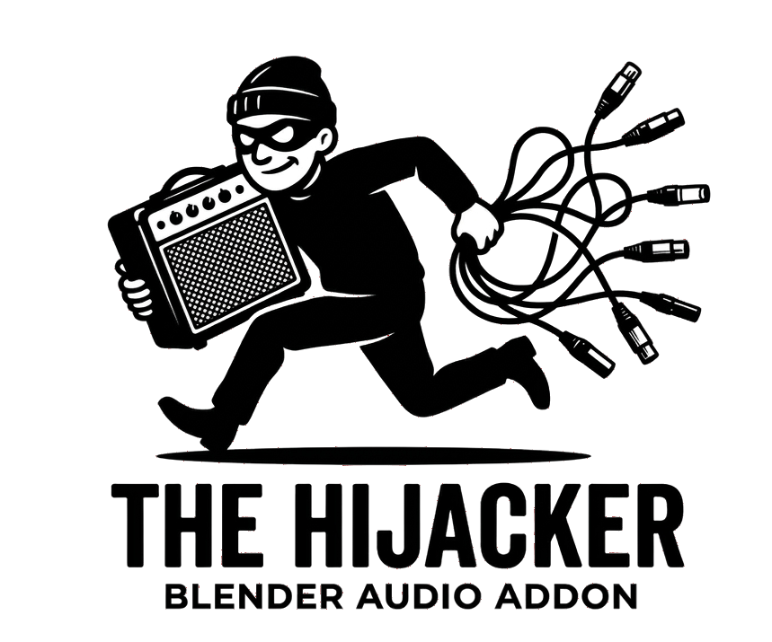

<p align="center">
  
</p>

<p align="center">
A professional audio mixing and processing suite for Blender's Video Sequence Editor, powered by a custom C++ audio engine that runs entirely independently of Blender's native audio system.
</p>

<p align="center">
  
  
  
  
  
</p>

> **Pre-release:** Every feature is in and working, and it has been tested by hand on Windows with Blender 4.5 and 5.2. The macOS and Linux engines are built but haven't been tried inside Blender yet. If something breaks, please [open an issue](https://github.com/lukefreeze/the-hijacker-blender-addon/issues) with the Blender console log.

<p align="center">
  <strong><a href="https://github.com/lukefreeze/the-hijacker-blender-addon/releases">⬇ Download the latest release</a></strong>
</p>

---

## What Is The Hijacker?

Blender's built-in audio tools are limited to basic volume and pan — there's no per-channel DSP, no real-time processing, and no way to route audio through effects chains. The Hijacker replaces Blender's audio playback entirely with a custom C++ engine that gives you a full mixing desk and AI processing suite directly inside Blender.

The engine (`hijacker_engine.pyd` / `.so`) is a compiled C++ extension handling all audio I/O, mixing, and DSP natively — bypassing Python's GIL and Blender's `aud` limitations entirely. The UI is a GPU-drawn HUD living in Blender's Node Editor, rendered with Blender's `gpu` module — no external GUI frameworks and no native windows.

---

## Features

### Mixing Desk
- Full 9-channel mixing desk rendered directly in Blender's Node Editor
- Per-channel: volume fader (with dB readout), gain knob, stereo pan, mute, solo
- Real-time VU meters with peak hold
- Scrollable, scalable HUD — fits any screen size and zoom level
- PNG skin system — full visual reskinning via `ui/assets/skins/default/`
- Table background aesthetic — the desk sits on a virtual studio table surface

### DSP Racks (real-time, per-channel)
| Rack | Controls |
|------|----------|
| **Compressor** (single-band) | Threshold, Ratio, Attack, Release, Makeup, Knee |
| **Compressor** (multiband) | 4-band with independent controls per band |
| **7-Band Parametric EQ** | Low shelf, 5× parametric, high shelf |
| **Reverb** | Freeverb algorithm — Room, Damping, Width, Wet, Pre-delay |
| **Noise Gate** | Threshold, Attack, Release, Hold, Range |
| **Stereo Delay** | Time, Feedback, Mix, Ping-pong, LP filter |

All DSP racks support presets accessible via ◄ ► arrows in the rack rail.

### Mixdown Rack
Renders your timeline audio to a file without leaving Blender:

- **Mix** — all channels summed to one stereo file; **Bake** — every channel rendered on its own with its effects baked in
- WAV (16 / 24 / 32-bit float) or FLAC, at 44.1, 48 or 96 kHz
- Whole timeline or a custom range, with auto-versioned file names
- Renders in the background so Blender stays responsive, then can mute, replace or keep the original channels

### DSP Processing Racks (real-time or offline, per-channel)
In addition to the effect racks above:

| Rack | What It Does |
|------|-------------|
| **Booster** | Volume amplification beyond Blender's strip volume cap — with soft limiter |

### Skins
The mixing desk and every rack are fully skinnable PNGs. Besides the default look there is a **PACK-A-PUNCH** skin mode, with its own rack artwork and a short intro transition the first time you switch to it.

### AI Racks (offline, background-threaded)
All AI racks run as background subprocesses — Blender stays fully responsive during processing. Each rack starts as an install screen: click once and it downloads its engine and models from their official sources (with a live percentage, resumable if your connection drops), then it becomes the working rack. Nothing AI-related is bundled in the add-on, and you can delete the downloaded models later from the add-on's settings.

| Rack | What It Does |
|------|-------------|
| **Voicefixer** | Voice restoration — repairs degraded, clipped or low-quality recordings |
| **Demucs** | Stem separation — splits a track into vocals, drums, bass, other, and adds each stem to the timeline |
| **KNNVC** | Voice conversion — converts recorded dialogue to a different voice, using a reference voice you supply |
| **Piper TTS** | Offline neural text-to-speech — one-click engine + starter voice download, then no internet or API keys needed. *The starter voice is public domain, so it is fine for commercial work — other catalogue voices vary, see [AI engines and models](#ai-engines-and-models).* |
| **Whisper** | Speech-to-text — transcribes audio and generates VSE subtitle strips |

Processing uses the strip as it sounds on your timeline (trim, volume and so on), and results come back as new strips. AI engines run in their own private Python environment, so they never touch Blender's own Python.

---

## Architecture

```
blender_sync/
  Loader.py                     ← Blender registration, sys.path bootstrap
  Racks.py                      ← All rack data, draw, hit-test, presets
  hijacker_native/              ← Compiled C++ engine, one folder per OS + Python version
    win_amd64_py311/ … py313/   ←   (.pyd — Blender 4.x / 5.x)
    macos_arm64_py311/ … py313/ ←   (.so)
    linux_x86_64_py311/ … py313/←   (.so)
  core/
    engine.py                   ← C++ extension import and lifecycle
    audio.py                    ← Playback handlers, seek, frame sync
    meters.py                   ← VU meter timer, peak hold, envelope cache
    properties.py               ← Blender PropertyGroups
    constants.py                ← All layout constants
    ai_*.py                     ← Per-AI-rack background processing modules
    audio_export.py             ← Mixdown / timeline-accurate audio export
  ui/
    mixer/
      mixer_hud.py              ← draw_callback_px, scrollbars, UI state globals
      interaction.py            ← Modal operator, hit testing, keyboard input
      channel_strip.py          ← One fader strip — all section draw logic
      draw_utils.py             ← GPU primitives, LED meter, numbox
      texture_cache.py          ← PNG → gpu.texture loader, SKIN_MAP
    assets/
      skins/default/            ← Active skin PNGs
      skins/working/            ← Development / source art (not distributed)
    racks/
      rack_base.py              ← Shared rack drawing utilities
      rack_comp.py              ← Compressor rack
      rack_eq.py                ← EQ rack
      rack_reverb.py            ← Reverb rack
      rack_noisegate.py         ← Noise gate rack
      rack_delay.py             ← Delay rack
      rack_demucs.py            ← Demucs rack UI
      rack_knnvc.py             ← KNNVC voice conversion rack UI
      rack_piper.py             ← Piper TTS rack UI
      rack_booster.py           ← Booster rack UI
      rack_voicefixer.py        ← Voicefixer rack UI
      rack_whisper.py           ← Whisper rack UI
      rack_mixdown.py           ← Mixdown rack UI
      install_panel.py          ← Shared install / progress screen for the AI racks
      *_pp.py                   ← PACK-A-PUNCH skin versions of the racks
  ai_engines/
    demucs/                     ← Demucs runner
    knnvc/                      ← KNNVC runner + voice models
    piper/                      ← Piper runner glue (the engine and voices are downloaded, not shipped)
    booster/                    ← Booster runner
    hj_download.py              ← Resumable downloader shared by the AI racks
    voicefixer/                 ← Voicefixer runner
    whisper/                    ← Whisper runner
src/                            ← C++ engine source
  hijacker_audio_engine.cpp     ← PortAudio real-time engine, WAV reader
  hijacker_processor.cpp        ← DSP effect chain (EQ, comp, reverb, gate, delay)
  wrapper.cpp                   ← pybind11 Python bindings
  mixer_ui.cpp                  ← Stub (UI is GPU-drawn in Python)
  imgui/                        ← Dear ImGui (compiled into the engine build; UI itself is GPU-drawn in Python)
include/                        ← C++ headers
build.bat                       ← Windows build script (MSVC + vcpkg PortAudio)
.github/workflows/build.yml     ← GitHub Actions cross-platform CI builds
```

---

## Installation

### Requirements
- Blender 4.5 or newer (4.5 and 5.2 are tested). Older versions aren't supported: for example Blender 4.1's built-in Python lacks a file (`python3.dll`) that the Whisper package needs.
- Windows x64. macOS and Linux engines are included but haven't been tested inside Blender yet.
- An internet connection the first time you install an AI rack (the engines and models are downloaded, not bundled). Everything works offline afterwards.

### Install the release
1. Download the latest `TheHijacker-<version>.zip` from the [Releases](https://github.com/lukefreeze/the-hijacker-blender-addon/releases) page
2. In Blender: `Edit → Preferences → Add-ons`, then click the **▼ dropdown** in the top-right of the Add-ons panel and choose **Install from Disk...** (or just drag the zip into the panel)
3. Select the zip as downloaded — don't unzip it first
4. Enable the checkbox next to **The Hijacker**
5. Open a Node Editor area and click **The Hijacker** button in the header

### Build from source (for contributors)
Only needed if you're working on the addon itself — everyone else should use the release zip above.
1. Clone the repo
2. In Blender: `Edit → Preferences → Add-ons`, dropdown → **Install from Disk...**
3. Point Blender at `blender_sync/Loader.py`
4. Enable **The Hijacker**

---

## Building the C++ Engine

The engine is pre-built for all platforms via GitHub Actions. If you need to build locally on Windows:

```bat
build.bat
```

Requires MSVC, Python headers (3.11 for Blender 4.x, 3.13 for Blender 5.x — see `build_py313.bat`), pybind11, and the PortAudio static lib. See `build.bat` for full dependency list.

Cross-platform builds (Windows / macOS / Linux) run automatically on every push to `main` (and the active development branch) via `.github/workflows/build.yml`. Download artifacts from the [Actions](https://github.com/lukefreeze/the-hijacker-blender-addon/actions) tab.

---

## Platform Support

| Platform | Engine Build | Tested in Blender |
|----------|-------------|-------------------|
| Windows x64 | ✅ | ✅ Blender 4.5 and 5.2 |
| macOS (Apple Silicon) | ✅ | Not yet tested |
| Linux x64 | ✅ | Not yet tested |

The AI racks are only tested on Windows so far. The Piper TTS rack has the code to fetch macOS and Linux engines, but those paths are untested.

---

## Roadmap

See [ROADMAP.md](ROADMAP.md) for the full development plan.

**Done:** the mixing desk, all DSP racks, the Mixdown rack, the five AI racks, the PACK-A-PUNCH skins, and a single zip that picks the right engine for your OS and Blender at load time.

**Still to come:**
- [ ] macOS and Linux real-world testing
- [ ] Undo support and save trigger

---

## License and Credits

The Hijacker is free software, licensed under the **GNU General Public License v3.0 or later** — see [LICENSE](LICENSE).

If you fork, modify or build on this project, the GPL requires you to keep it open under the same licence, and the author attribution in [NOTICE.md](NOTICE.md) must be preserved in your version's source and credits.

### About this project

The Hijacker was created by Luke Bridger, an animator, with AI assistance (Claude by Anthropic). I designed the tool and its look, directed the work, and tested it by hand throughout. Much of the code was written by AI under that direction, and AI tools were also used in making some of the artwork. It's released as open source so people can use it, learn from it and improve it.

### AI engines and models

The Hijacker **does not include any AI engine, model or voice**. The AI racks (Piper TTS, Demucs, kNN-VC, VoiceFixer, Whisper) download their software and model files from their official sources when you choose to install them, and each remains under its own licence. See [THIRD_PARTY_NOTICES.md](THIRD_PARTY_NOTICES.md). Voice models and voice-conversion tools carry their own usage terms — check them before publishing results, and only convert voices you have the right to use.

**Commercial use:** the starter voice the Piper rack downloads (`en_US-ljspeech-medium`) is trained on public-domain data, so its output is free to use commercially with no royalties or credit. The rack can also download other voices from Piper's public catalogue, and those vary: some need credit (CC BY) and a few — including Lessac- and Ryan-based voices — are non-commercial only. The VoiceFixer models are CC BY 4.0, which requires credit. [THIRD_PARTY_NOTICES.md](THIRD_PARTY_NOTICES.md) has the details for each. The zip ships with that file and with the licence texts for the libraries compiled into the engine (PortAudio, pybind11, Dear ImGui).

### Thanks

The PACK-A-PUNCH skin mode is a tip of the hat to *Call of Duty* for the idea; this project isn't affiliated with Activision.
